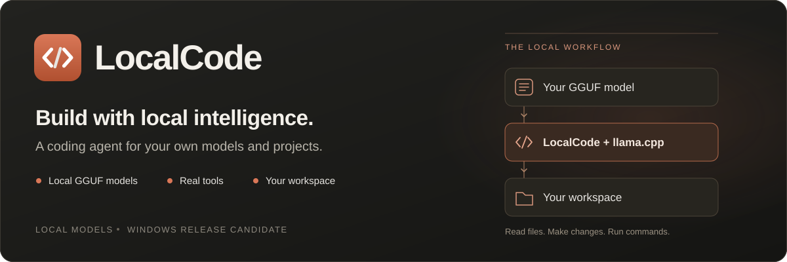

<p align="center">
  
</p>

<p align="center">
  <strong>Your models. Your projects. A clear record of the work.</strong><br>
  A native desktop coding assistant powered by GGUF models and llama.cpp.
</p>

<p align="center">
  <a href="https://github.com/Polterpup2008/LocalCode/releases/tag/v1.2.0"></a>
  
  
  <a href="LICENSE"></a>
</p>

<p align="center">
  <a href="https://github.com/Polterpup2008/LocalCode/releases/download/v1.2.0/LocalCode-1.2.0-Windows-x64-Setup.exe"><strong>Download installer</strong></a>
  &nbsp; · &nbsp;
  <a href="https://github.com/Polterpup2008/LocalCode/releases/download/v1.2.0/LocalCode-1.2.0-Windows-x64.zip"><strong>Download portable ZIP</strong></a>
  &nbsp; · &nbsp;
  <a href="docs/GETTING_STARTED.md">Getting started</a>
</p>

LocalCode brings your local model into a workspace with file search, editing,
command execution, saved conversations and change review. Give it a focused
task, follow the tools it uses, and inspect the evidence behind its answer.

The Windows package includes **llama.cpp.localcode** and Qt. Bring a compatible
GGUF model; a manual server setup is optional. No Visual Studio installation is
needed to run the app.

**New in 1.2:** incomplete tool calls no longer poison retries or saved chats.
Rejected batches run no tools, recovery is bounded, and Models exposes a separate
reply-token limit in a scrolling profile form. Read the
[release notes](docs/RELEASE_NOTES_1.2.md).

Command history also preserves Unicode log paths, so accented output-folder
names can be replayed in the next model request.

**From 1.1:** lightweight conversation, visible Chat/Code modes, automatic
GPU-layer fitting, memory-aware starting profiles and a bundled Vulkan fallback
for computers whose CUDA backend cannot initialize. The familiar orange/grey
layout, expanding prompt editor and steady chat scrolling remain.

A greeting should not carry an entire coding task. In the controlled local
comparison, its prompt fell from **8,637 tokens to 97**, with the same model,
32K context capacity and f16 cache. First-token latency was **0.265 s on CUDA**
and **0.449 s in the separate 0.8B CPU check**, excluding model startup.
These are measured examples on one laptop; read the
[results, first-use Vulkan cost and hardware limits](docs/benchmarks/2026-10-23-low-end.md).

The Windows 10/11 x64 package is unsigned. The reported GTX 1650 Ti laptop still
needs a direct check; see the [1.1 hardware checklist](docs/KNOWN_LIMITATIONS_1.1.md).

## From model to working folder

1. **Install or extract.** Launch LocalCode from the Start menu, or extract the
   full portable ZIP and run `bin\LocalCode.exe`. The installer offers an optional
   **LocalCode Discord plugin** component.
2. **Add your model.** Choose **File → Add GGUF model…**, select your `.gguf`,
   review its metadata and load it. LocalCode references the file in place.
3. **Choose where to work.** Open a project folder, or use **File → Work without
   a project** to create a persistent dated output folder.
4. **Give it a small first task.** Press **Ctrl+Enter** to send. Review **Changes**,
   tool results and command output as it works.

Try a request with a clear scope and a check:

> Read the README and the calculator tests. Fix the addition bug, run the tests,
> and report the actual result. Keep the change small.

Compilers, interpreters and other tools used by your project must be installed
separately. A local model does not supply a development toolchain.

## A coding workspace, with the evidence in view

| What you need | What LocalCode provides |
|---|---|
| Work on real files | Workspace search, file reads and edits, an editor and a changes view. |
| Follow the work | Tool activity, command output and visible approval requests. |
| Check the result | Separate records for configure, build, tests, execution, behaviour and the task objective. |
| Use your own model | GGUF metadata inspection, model profiles, context and GPU-layer controls; capabilities depend on the model and runtime. |
| Chat without coding overhead | Auto recognizes greetings; Chat omits project tools; Code keeps the complete agent workflow. |
| Start without a repository | A unique dated output folder that stays on disk after closing the app. |
| Pick up later | Saved conversations and session recovery; right-click a chat to delete it without deleting project files. |
| Connect your Discord bot | An optional plugin, configured from the app with your own bot credentials, model and permitted channels. |
| Keep project conventions | Repository instructions from `AGENTS.md`, `CLAUDE.md` or `LOCALCODE.md`, plus built-in procedural skills. |
| Automate or troubleshoot | `localcode-doctor` exposes runtime discovery, model inspection and the agent loop through a CLI. |

### Completion should come with something you can inspect

A successful command and a correct feature are different claims. LocalCode
tracks the commands and file evidence behind a task, marks checks stale after
relevant edits, and checks completion claims against its record. Missing evidence
can trigger a request for further checks.

That record still has a scope: a model can choose an incomplete test or
misunderstand the request. Review the criteria, actual output and diff.
Read [how verification works](docs/VERIFICATION_MODEL.md).

## The runtime is included. The choice stays yours.

**Default:** LocalCode starts and stops its bundled **llama.cpp.localcode**
runtime when you load and unload models. The primary runtime includes upstream **b11829** with a
LocalCode Windows memory optimization. In the matched 9B test, resident process
memory fell from **5.27 GiB to 0.52 GiB**, retaining the same 32K context, f16 cache
and output tokens. No decode speed gain is claimed. See the
[benchmark results and limits](docs/benchmarks/2026-10-23-runtime.md).

Version 1.1 also includes a matching **Vulkan alternative**. It probes actual
devices before selecting a compatible backend and reports the model's actual
GPU layer count after loading. A detected GPU alone is never shown as proof of
GPU inference. New low-memory profiles have conservative context recommendations;
manual presets and placement controls remain available.

**Custom runtime:** select **Settings → Models → Custom llama.cpp** and choose
your `llama-server.exe`, keeping its supporting DLLs together. A model must be
supported by the runtime and its chat template. RAM, VRAM and GPU-driver
requirements depend on your model, context size and selected backend.

**Existing server:** leave **Use a server I started myself** unchecked for normal
use. Enable it only to connect to a server you already run; LocalCode will not
start or stop that external server.

## Discord, when you want it

Select **LocalCode Discord plugin** on the installer's **Choose Components**
page to add the integration. It is optional and unchecked by default. Setup
installs its worker, manifest and clean configuration; it does not connect a bot.

Open **View → Plugins** in LocalCode, enter your own Discord bot credentials
and allowed server/channel IDs, choose a compatible model and runtime, then
save and start it. No credentials, private persona or chat history are shipped.
See the [setup guide](docs/GETTING_STARTED.md#optional-discord-plugin).

## Before you use it on important work

The 1.1 checks include real CPU/CUDA greeting comparisons, a 4B Vulkan fallback,
context-preserving placement with a restricted memory budget, and a coding task
that edited and tested a small project. Automated and package checks are recorded
in the [validation record](docs/benchmarks/2026-10-23-low-end-validation.json).
Earlier installer and user-data-preservation checks remain documented in the
[1.0 release history](docs/RELEASE_STATUS_1.0.md).

The app is **unsigned**. File tools check workspace boundaries and commands use
application policies and approvals, but **OS-level command confinement is not
implemented**. Approved commands run with your account's access. Review changes
and commands, and keep version control or backups. See
[known limitations](docs/KNOWN_LIMITATIONS_1.1.md) and
[security boundaries](docs/SECURITY.md).

## Build from source

For a local build for your own use under the [license](LICENSE): **CMake 3.24+**,
a **C++23 compiler** (MSVC 2022 17.8+ on
Windows), and **Qt 6.5+** with Core, Gui, Widgets and Concurrent for the desktop
app. CMake fetches the remaining source dependencies during configuration.

On Windows, the Visual Studio preset selects the x64 toolchain. Replace the Qt
path with your installed MSVC x64 kit:

```powershell
git clone https://github.com/Polterpup2008/LocalCode.git
cd LocalCode
cmake --preset windows-release-vs -DCMAKE_PREFIX_PATH=C:/Qt/6.9.1/msvc2022_64
cmake --build --preset windows-release-vs
ctest --test-dir build/windows-release-vs -C RelWithDebInfo --output-on-failure
```

A source build needs a runtime supplied separately or a prepared runtime bundle;
the downloadable Windows packages already include one. To build the core and
its tests without Qt, use the `windows-core` preset from an MSVC developer
prompt, or `linux-core` on Linux. The current packaged desktop release targets
Windows x64.

## Explore further

| | |
|---|---|
| [User guide](docs/GETTING_STARTED.md) | Models, projects, chats, output folders and settings |
| [Release notes](docs/RELEASE_NOTES_1.1.md) | What's included in 1.1 |
| [Runtime guide](docs/BACKENDS.md) | Backend discovery and server management |
| [Model guide](docs/MODELS.md) | GGUF metadata, capabilities and profiles |
| [Architecture](docs/ARCHITECTURE.md) | The native core, desktop app and data flow |
| [Contributing](CONTRIBUTING.md) | Development workflow and project conventions |

## License and acknowledgements

LocalCode's source is visible under a [proprietary license](LICENSE). You may
download and run official binaries and build locally for your own personal or
internal business use. Redistribution, resale and reuse in other products
require permission. Rights already granted for earlier MIT-licensed versions
remain under those versions' terms.

It builds on Qt,
[llama.cpp](https://github.com/ggml-org/llama.cpp) and other open-source projects.
Bundled components retain their own licenses; see
[third-party notices](docs/THIRD_PARTY_NOTICES.md).
