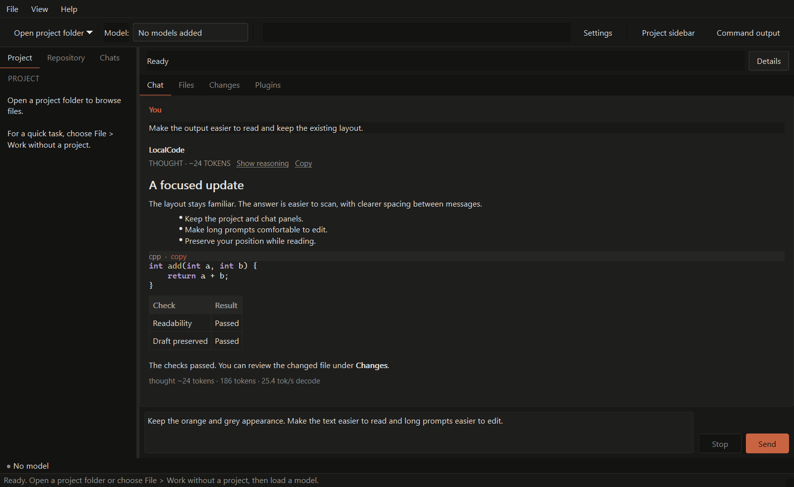
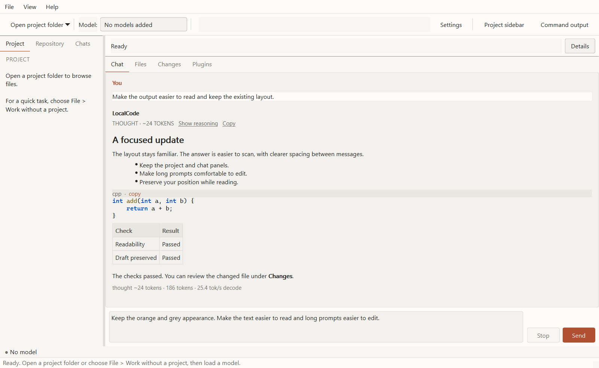

# LocalCode RC5 UI update

RC5 keeps the existing panels, navigation and orange/grey appearance. It focuses
on reading and editing comfort and crowded controls.

- **Readable text:** slightly larger interface type, consistent rich-text font,
  clearer message separation, and larger detail-panel text.
- **Comfortable prompts:** wrapped paragraphs expand the editor; resizing wider
  or clearing text shrinks it. The existing line cap and scrolling remain.
- **Steadier chat:** new assistant segments and theme refreshes retain your
  reading position. **Jump to latest** resumes following output from a separate
  row below the chat, with no floating control over other buttons.
- **Controls that fit:** model actions use a two-column group; long form rows
  wrap. Hover does not move controls. Splitter handles are easier to grab.
- **Clearer starting points:** the empty project sidebar stays aligned at the
  top and explains how to start. The project toolbar menu includes **Work
  without a project**. The empty model selector uses a short readable label.

## Rendered previews

These are captures of the production Qt widgets with a synthetic transcript,
not a live model run. The same layout is available in both themes.

## Validation

The baseline reproduced a ten-line wrapped paragraph remaining in a three-line
editor, and a new assistant segment moving scroll position from 0 to 1464 while
the reader was at the top. Both cases now pass regression checks.

The full GUI suite passed **104 cases and 4,310 assertions**, with **six existing
opt-in skips**. Focused review, including additional font diagnostics, then passed
**5 cases / 641 assertions**, both at normal scaling and with
`QT_SCALE_FACTOR=1.5`. Main windows were reviewed at 1280×800 and 900×620 logical
pixels; the model panel at 280px wide; all eight Settings pages at 640×560, in
both themes. Visible button rectangles were checked for overlap before and during
hover. Keyboard send, newline and stop behavior, draft sizing and scroll-follow
behavior were exercised through Qt APIs. Font diagnostics resolve the sampled
heading, paragraph and table header to Segoe UI on the test system.

[Machine-readable validation](benchmarks/2026-10-23-ui-validation.json).

No OS mouse/keyboard control was used. This does not replace the remaining
installed-GUI checks in the [release status](RELEASE_STATUS_1.0.md). Only text
symptoms were supplied; this update addresses those symptoms and the reproduced
cases without claiming every possible UI defect is fixed. No model speed or FPS
gain is claimed. The qualified RC4 runtime, context settings, optional Discord
worker and license terms are unchanged.
